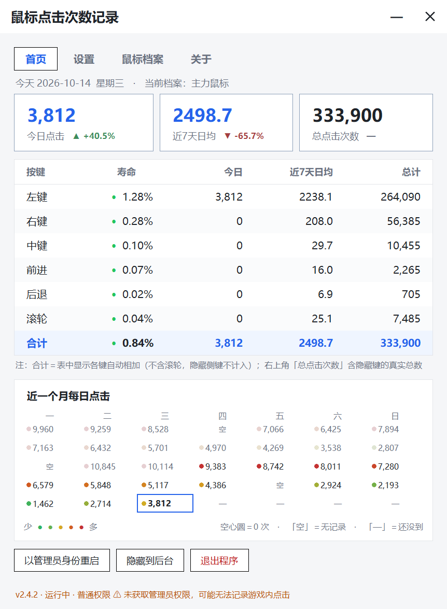
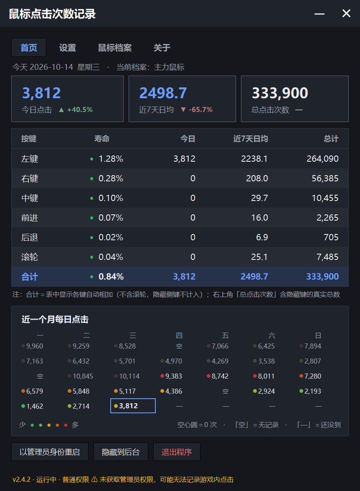
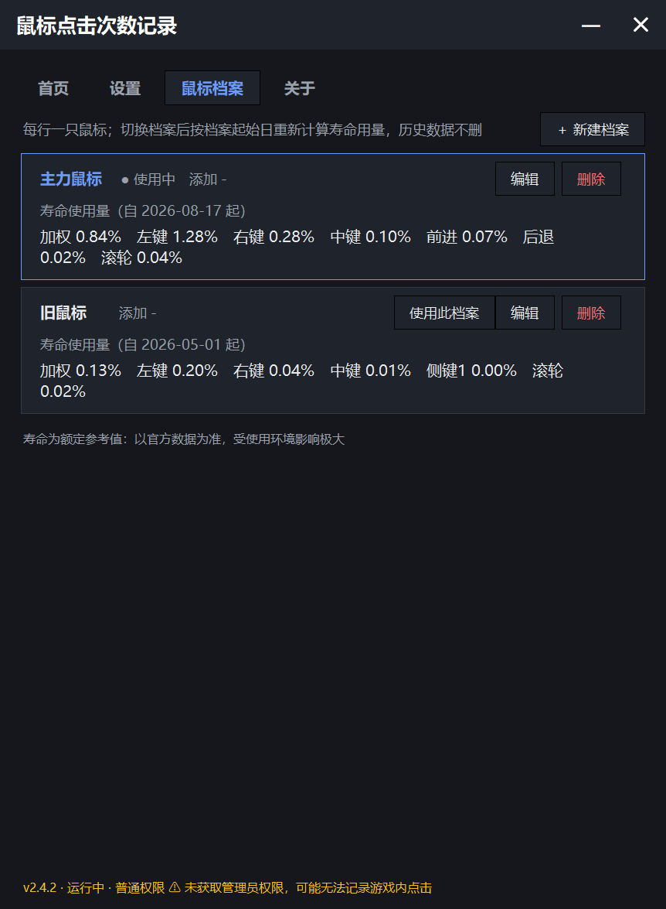
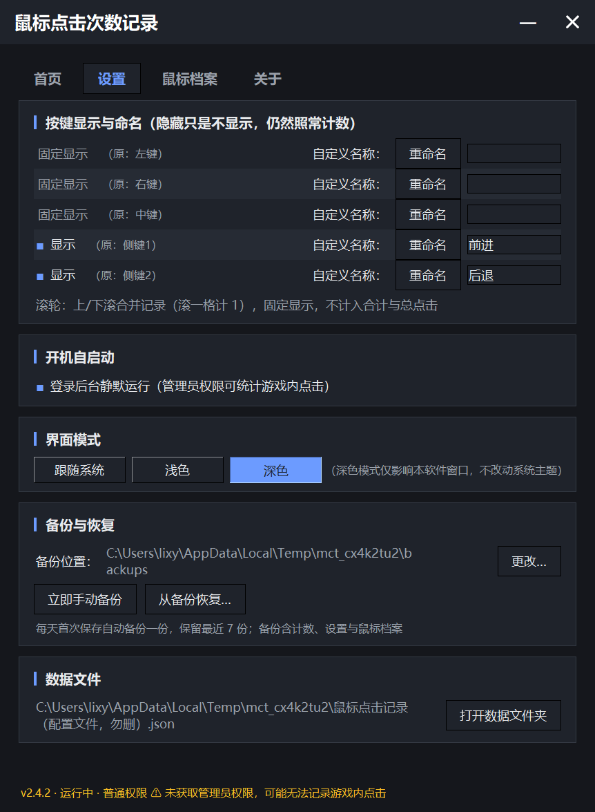

# 鼠标点击次数记录

Windows 下的鼠标按键点击次数统计小工具：底层鼠标钩子计数 + tkinter 统计窗口 + 右下角托盘常驻，
单文件 exe，免安装、不依赖 Python。

## 游戏内使用

本工具用全局鼠标钩子统计所有点击。目前实测**三角洲行动、英雄联盟、明日方舟：终末地均未触发 ACE 反作弊的风险判定**，
个人测试较为安全；反作弊策略可能随时调整，风险请自行评估。

## 碎碎念

上一个鼠标用了一年半因为左键双击报废了，为了记录新鼠标的使用次数和频率，用deepseek
加千问花了差不多20多完成该软件，功能单一仅供娱乐。后来一路改到 v2.4.4，加上了鼠标档案、微动寿命预测、
滚轮计数和热力日历，代码也重写过几轮，现在约 3650 行、仍是单文件纯标准库。

下载：[Releases](../../releases) 里选最新版本，直接下载里面的 exe（建议下载最新版，v2.2.0 及更早是 rar 压缩包，解压后用）。

## 能做什么

- 统计 **左键 / 右键 / 中键 / 侧键1 / 侧键2** 五类按键的点击次数，**滚轮按格单独记录**
  （高清滚轮按 120 delta 累积进位，不会系统性少计；不计入点击总数）
- 首页三张 KPI 卡：**今日点击 / 近 7 天日均 / 总点击次数**，右上角带环比箭头（涨▲绿 跌▼红）
- 按键明细表五列：**按键 / 寿命 / 今日 / 近 7 天日均 / 总计**，行悬停高亮，寿命列带同色圆点
- **近 28 天热力日历**：小圆点颜色表示当天用量，绿→黄→橙→红（接近 8000 次变红），
  非本月的补位日期自动淡化，还没到的日子画「—」，悬停看明细
- **鼠标档案 + 微动寿命预测**：换鼠标新建一条并填各键额定寿命（万次），用量按档案独立统计，
  接近额定值时圆点变红；托盘右键可快速切换档案
- 右下角托盘常驻：左键唤回窗口，右键菜单（控制面板 / 切换鼠标档案 / 退出程序），悬停显示「今日 N 次｜总计 N 次」
- **支持统计游戏内点击**：双击 exe 会弹一次 UAC 提权确认，允许后即可统计带反作弊的游戏里的点击；
  实测三角洲行动、英雄联盟、明日方舟：终末地均未触发 ACE 风险判定；点「否」也不影响普通软件统计。
  窗口里有「以管理员身份重启」按钮可临时切换权限
- 状态栏实时显示当前权限（管理员/普通）、钩子自诊断（正常/疑似被拦截）和今日次数；
  检测到钩子被拦截或后台线程异常会自动重装/重启尝试自愈
- **浅色 / 深色 / 跟随系统** 三态界面模式，切换即时重建，不用重启
- 支持开机自启动，可一键开关；管理员权限下自动注册为「最高权限」计划任务——开机静默驻留托盘、不弹 UAC，
  游戏内点击照常统计
- 自启动可迁移：整个文件夹换位置、换电脑后，手动打开一次程序即自动修复启动项
- 单实例运行：重复启动只会把已有窗口叫回来，不会开出第二个
- 数据按天存成本地 JSON，自动保存（最多丢 3 秒）；**每天自动备份一份，保留最近 7 份**，
  恢复对话框会列出每份备份的文件名、点击总量和时间戳，不怕选错
- 按键可隐藏、可重命名，不常用的侧键不用留在一页里

| 首页（浅色） | 首页（深色） |
|---|---|
|  |  |

| 鼠标档案 | 设置 |
|---|---|
|  |  |

## 快速上手

**方式一：直接用 exe**

去 [Releases](../../releases) 下载对应版本的 exe（当前是 `V2.4.4.exe`），放到任意文件夹里双击即可，
不需要解压、不用装 Python。首次会弹一次 UAC 和一段免责声明（涉及游戏内点击的账号风险，请自行评估）。
仓库里从源码打包出来的文件名带完整前缀（`鼠标点击计数V2.4.4.exe`），Release 里传的是简写名，同一个文件。

**数据不在 exe 旁边**，而是在文档目录：

```
%USERPROFILE%\Documents\鼠标点击次数记录\
  鼠标点击记录（配置文件，勿删）.json     ← 唯一权威数据
  backups\                                ← 每日自动备份 + 手动备份
  tray.log / error.log                    ← 运行日志
```

所以删除或更换程序文件夹都不会丢历史记录；程序按
「文档 → 用户目录 → 程序目录\config → 程序目录 → 旧名目录 → LOCALAPPDATA」的顺序找历史数据并就地接管。

**方式二：从源码运行**

```powershell
python mouse_counter.py           # 起界面 + 托盘
python mouse_counter.py --dump    # 不起窗口，命令行打印当前档案、今日、近 7 天日均与总计
```

## 环境要求

- Windows 10 / 11 x64
- 从源码运行需要 Python 3.10（只用标准库，**没有任何第三方依赖**）

## 资源占用

用的是 Windows 底层鼠标钩子 `WH_MOUSE_LL`，回调里只做计数和入队，不阻塞鼠标输入。
空闲时 CPU 约 0%，主进程内存约 20 MB，窗口隐藏后同样保持监听。

任务管理器里会看到两个同名进程——这是单文件 exe 的正常现象（一个是解包引导，一个是主程序），
只有主程序带窗口。

## 从源码打包 exe

需要 PyInstaller（`python -m pip install pyinstaller`）。图标和版本资源用绝对路径引用，
`.spec` 落在 `构建/`：

```powershell
python -m PyInstaller --noconfirm --clean --onefile --noconsole `
  --name "鼠标点击计数V2.4.4" `
  --add-data "$PWD\icon.ico;." --icon "$PWD\icon.ico" `
  --version-file version_info.txt `
  --distpath _pkg_tmp\dist --workpath _pkg_tmp\build --specpath 构建 `
  mouse_counter.py
```

发版要同步四处版本号：`mouse_counter.py` 的 `APP_VERSION`、`version_info.txt`（4 个字段）、
`构建/` 里的 spec 名、`更新日志.md` 新条目。跑 `python 测试/check_version.py` 会替你卡住前三处。

## 测试

```powershell
python 测试/run_tests.py            # 84 项回归，headless 起真窗口
python 测试/probe_tray_win32.py     # 真 Win32 托盘窗口/消息循环探针
python 测试/check_version.py        # 版本号三处一致性闸门
python 测试/check_frozen.py         # 打包产物静态核对（不启动 exe）
```

测试脚本一律走 `测试/env.py` 的 `isolate()` + `silence_backend()` 把数据目录搬到临时位置——
**它们的默认值就是文档目录，也就是你的真实数据**，不打桩的脚本会直接覆盖生产数据。

## 卸载

1. 设置页取消勾选「开机自启动」（或托盘菜单里取消）
2. 托盘右键 → 退出程序
3. 删除程序文件夹；想连历史数据一起清掉，再删 `%USERPROFILE%\Documents\鼠标点击次数记录\`

## 已知限制

- 非管理员权限时，游戏内（DirectInput 独占 / UIPI）的点击不计数——状态栏会提示当前权限级别
- Windows 11 默认把新托盘图标收进「^ 隐藏的图标」，只能手动拖出来常驻，程序无法强制
- 托盘右键菜单由系统绘制，不随深色模式变色
- 中键 / 侧键只有鼠标真的发出对应消息时才会计数
- **横向滚轮不统计**；多设备无法分别计数（要 Raw Input 另起一套架构）
- 无边框自绘标题栏，拖窗口的代价是**没有 Aero Snap 贴边分屏、也没有甩动最小化**
  （换来的是拖动跟手不闪退，v2.4.3 试过交给系统，结果 Tcl 不可重入直接 abort）
- exe 未做代码签名：首次在别的电脑运行可能弹 SmartScreen，点「更多信息 → 仍要运行」即可
- 数据只增不清理；小时分布需要 `version=4` 先记小时桶（暂缓）

## 数据与隐私

纯自用工具：不联网、不上传、无遥测、无云服务。所有记录都在文档目录里的 JSON 文件。

## 其他

版本变更记录见 [更新日志.md](更新日志.md)，当前版本 **v2.4.4**。

结构拆解、关键机制与踩坑记录见 [文档/项目说明.md](文档/项目说明.md)，
接手本项目要先读的当前状态快照在 [文档/交接文档.md](文档/交接文档.md)。

作者：黎修源。本项目未附带许可证文件，若要公开授权方式请自行在仓库里补 `LICENSE`。
